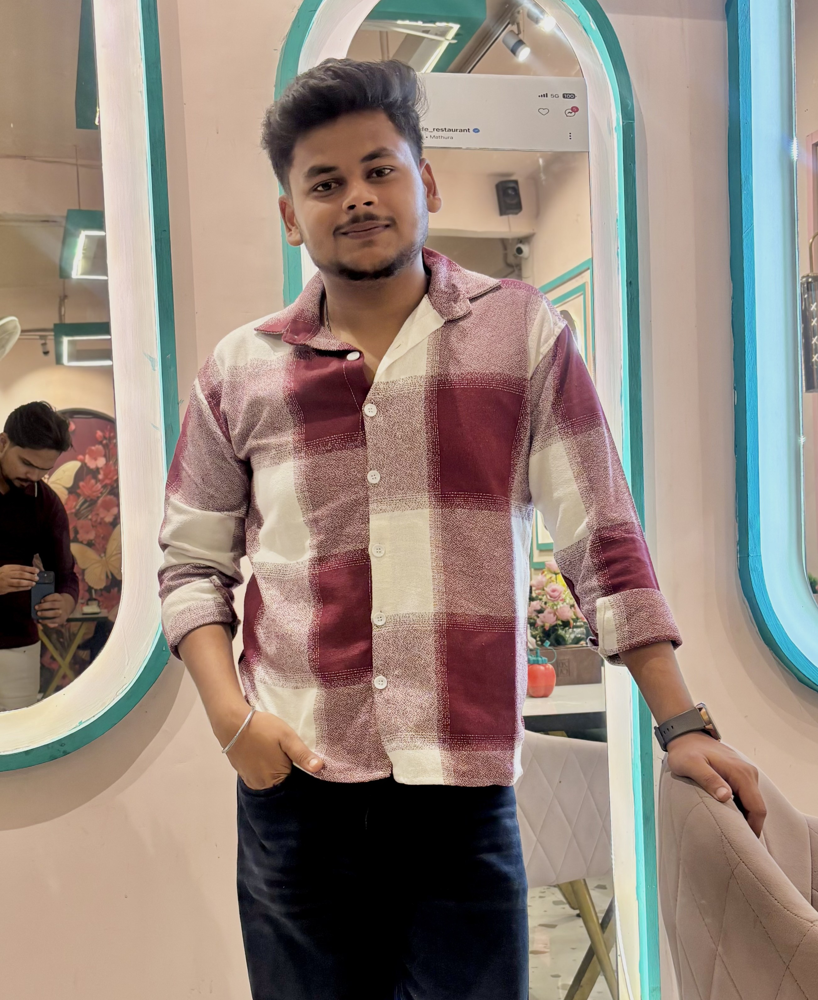

 

<!-- SPACE HEADER -->

🌙　✨　🪐　🚀　⭐　🛰️　☄️

 

---

# 👨‍🚀 ABOUT ME

<table>
<tr>
<td width="34%" align="center" valign="middle">

  

**TANISH UTTAM**

Computer Science Engineer

 

📍 India

🎓 Sanskriti University

💻 Developer & Innovator

</td>
<td width="66%" valign="middle">

Hey there! I'm **Tanish Uttam**, a Computer Science and Engineering student at Sanskriti University, passionate about technology, business innovation, product development, and solving real-world problems.

I believe great products are built when technology, creativity, business understanding, and data come together.

I enjoy developing web applications, exploring Artificial Intelligence, understanding user needs, analysing problems, and discovering how businesses create and scale successful products.

I've worked on projects like **The Grievance Hub** and **StackStart**, and gained professional experience as a Frontend Developer Intern at Saemos.

Beyond coding, I'm interested in product strategy, business development, analytics, marketing, and innovation.

**My mindset:** Think beyond code. Understand problems. Build solutions. Create impact.

</td>
</tr>
</table>

---

# 🎯 OPEN TO OPPORTUNITIES

**TECHNOLOGY × PRODUCT × BUSINESS × ANALYTICS**

I'm actively exploring internships, entry-level positions, and professional opportunities across multiple domains.

| Domain | Interested Positions |
|---|---|
| 🤖 Artificial Intelligence | AI Intern, AI Associate, AI Product Associate |
| 🚀 Product Management | Product Management Intern, Associate Product Manager |
| 📊 Product Analytics | Product Analyst, Product Operations Associate |
| 📈 Data Analytics | Data Analyst Intern, Business Analyst |
| 💼 Business Development | Business Development Associate (BDA), Business Development Intern |
| 📣 Sales | Sales Associate, Sales Development Representative |
| 📢 Marketing | Digital Marketing Intern, Marketing Associate |
| 🌱 Growth & Strategy | Growth Associate, Strategy & Operations Intern |
| 💻 Software Development | Frontend Developer, Full Stack Developer, MERN Stack Developer |

I bring a technical foundation, analytical thinking, curiosity about business, communication skills, creativity, and a strong willingness to learn.

I'm particularly interested in roles where I can understand customer needs, identify opportunities, analyse information, collaborate with teams, and contribute to building or growing impactful products.

---

# 🛸 TECHNOLOGY COMMAND CENTER

### Programming Languages

### Frontend Development

### Backend Development

### Databases & Tools

### Business & Analytical Interests

- Artificial Intelligence and AI-powered solutions.
- Data Analysis and Business Intelligence.
- Product Development and Product Strategy.
- Business Development and Market Research.
- Sales, Marketing and Growth Strategies.
- Customer Understanding and Problem Solving.

---

# 🚀 FEATURED PROJECTS

<table>
<tr>
<td width="50%" valign="top">

### 🔷 The Grievance Hub

**Smart Campus Complaint Management System**

A centralized digital platform designed to streamline complaint management in educational institutions.

- Location-based complaint submission.
- Anonymous complaint functionality.
- Admin management dashboard.
- Automated complaint escalation.
- Email and notification integration.

**Focus:** Transparency, Accountability and Digital Transformation.

`MERN STACK` `REST API` `AUTOMATION`

</td>
<td width="50%" valign="top">

### 🟣 StackStart

**Full-Stack Development Learning Platform**

A responsive platform designed to help beginners explore full-stack development.

- Structured learning paths.
- HTML, CSS and JavaScript courses.
- React, Node.js and MongoDB learning sections.
- Interactive navigation.
- Dark mode and dynamic UI.

**Focus:** Interactive Learning and User Experience.

`HTML5` `CSS3` `JAVASCRIPT`

</td>
</tr>
</table>

---

# 📡 GITHUB ANALYTICS CENTER

  

---

# 🐍 CONTRIBUTION SNAKE

---

# 🌠 DEVELOPER ACTIVITY

---

# 🏆 ACHIEVEMENTS & CERTIFICATIONS

| Achievement | Details |
|---|---|
| 🥇 Smart India Hackathon 2024 | Cultural Heritage Tourism Platform |
| 🚀 AI Startup Buildathon 2026 | Beauty Salon Marketplace Challenge |
| 📊 Power BI Training | Government of India / MeitY-backed |
| 🎓 Full-Stack Development | University of London (Goldsmiths), Coursera |
| 🤖 Google AI Professional | Google, Coursera |

---

# 💼 PROFESSIONAL EXPERIENCE

### Frontend Developer Intern — Saemos

**May 2026 – June 2026 | 2 Months**

- Developed responsive user interfaces for modern web applications.
- Created reusable frontend components.
- Applied component-based architecture.
- Focused on accessibility, usability, and UI consistency.
- Followed modern frontend development practices.

---

# 🎓 EDUCATION

### Bachelor of Technology — Computer Science & Engineering

**Sanskriti University, Mathura, Uttar Pradesh**

August 2023 – Present

**Relevant Coursework:**

Data Structures & Algorithms · DBMS · Operating Systems · Computer Networks · Object-Oriented Programming · Artificial Intelligence · Cloud Computing

---

# 🤝 LET'S CONNECT

I'm always excited to connect with developers, recruiters, founders, product managers, business professionals, and people working on innovative ideas.

Open to learning, collaboration, internships, and opportunities where I can contribute my technical knowledge and business-oriented mindset.

  

🌙　⭐　🪐　🚀　🛰️　✨　☄️

### THINK BIG. BUILD SMART. CREATE IMPACT.

*"Technology creates possibilities. Business creates opportunities. Innovation brings them together."*

